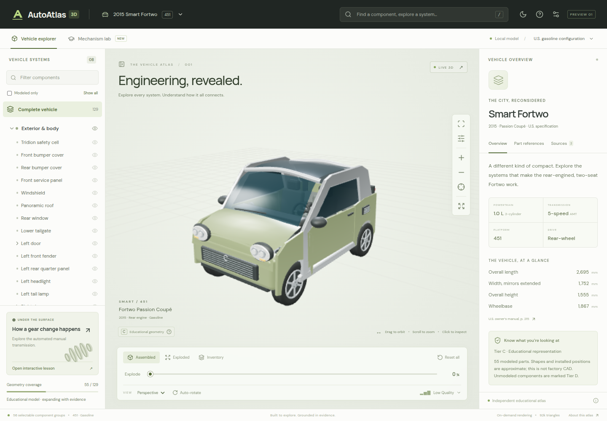

# AutoAtlas 3D

A working automotive anatomy explorer for the **2015 U.S. smart Fortwo Passion coupé, 451 gasoline platform**. React, TypeScript and raw Three.js power a real interactive GLB viewer, component catalog and conceptual automated-manual transmission lesson.

**This release is an educational vertical slice, not a factory-accurate digital twin.** All shipped geometry is Tier C. Missing geometry is explicitly Tier D. Three manufacturer part identities are sourced; **zero fitments are confirmed** for this exact gasoline configuration. No torque values, repair instructions, live prices or aftermarket compatibility are invented.



## Run locally

Node.js 22.12+ (CI uses Node 24):

```sh
npm ci
npm run dev
```

Open `http://localhost:5173`. No account, database or API key is required. Vehicle GLB, Meshopt decoder, fonts and catalog JSON are served locally. Optional VIN decoding contacts NHTSA only when requested and does not persist the VIN.

## Explore

- Drag to orbit; right-drag or two-finger drag to pan; scroll or pinch to zoom.
- Select a mesh or search the component tree. Selection groups represent physical components, not temporary mesh UUIDs.
- Hide systems, focus or isolate a component, reveal neighbors, or make selected components transparent.
- Use X-ray and longitudinal/cross/horizontal section planes.
- Use front/rear/side/top/underbody/interior camera presets and auto-rotation.
- Explode visible parts radially or arrange them in an inventory. Reset restores all original transforms and visibility.
- Open Mechanism Lab to scrub/play/pause/restart a six-stage clutch-release lesson. Geometry, timing and travel are explicitly conceptual; gearbox and actuator internals are not fabricated.
- Inspect OEM-reference evidence and source limitations separately from geometry accuracy.
- Switch light/dark appearance, lighting and rendering quality. Adaptive quality recognizes software renderers and lowers quality during slow auto-rotation. Reduced-motion preferences disable automatic rotation and smooth camera travel.
- On phones, catalog/inspector sheets preserve a visible vehicle viewport. Keyboard controls and the 2D catalog remain usable without WebGL.

## Current coverage

| Area           | Shipped scope                                                                                                                                                                                       |
| -------------- | --------------------------------------------------------------------------------------------------------------------------------------------------------------------------------------------------- |
| Configurations | One: 2015 U.S. 451 Passion coupé, 1.0 L three-cylinder gasoline, five-speed automated manual. Exact VIN equipment, engine/transmission codes and production intervals remain unverified.            |
| Catalog        | 139 entries across 8 systems, including 10 assembly entries and 129 part entries.                                                                                                                   |
| Geometry       | 56 selectable groups: 55 part entries plus the clutch-actuator assembly. All Tier C. Assembly rows can select their descendant meshes. 74 part entries have no geometry (Tier D).                   |
| Model          | Original procedural model exported to GLB; about 92k triangles / 0.64 MB with Meshopt. Overall proportions follow cited dimensions; part geometry and pivots are approximate.                       |
| OEM references | Clutch actuator 4512500062; headlamps 4518202459 and 4518202559. The headlamp source is an Electric Drive catalog, explicitly not confirmation for gasoline. All three fitment records are unknown. |
| Animation      | Conceptual clutch release / gear-change timeline. An imported glTF clip adapter is available for future licensed mechanisms; no OEM animation is included.                                          |
| Database       | Normalized PostgreSQL migration, RLS, evidence constraints and seed; embedded PostgreSQL tests. UI uses the bundled static JSON snapshot. No live Supabase instance provisioned.                    |

Some educational groups combine related shapes (for example wheel/tire, spring/damper and cylinder head/cover). Counts describe catalog entries and selectable groups, not a verified factory service-parts inventory. Serviceability remains unknown.

Accuracy tiers: **A** engineering/dimensionally verified; **B** visually validated with recorded evidence; **C** educational; **D** missing geometry. No A or B geometry is claimed in this release.

## Commands

| Command                   | Purpose                                                                                                                        |
| ------------------------- | ------------------------------------------------------------------------------------------------------------------------------ |
| `npm run dev`             | Local Vite server                                                                                                              |
| `npm run check`           | Strict TypeScript checking                                                                                                     |
| `npm run lint`            | ESLint                                                                                                                         |
| `npm run test`            | Vitest catalog, geometry-layout, input and PostgreSQL tests                                                                    |
| `npm run test:e2e`        | Chromium desktop/mobile acceptance scenarios                                                                                   |
| `npm run validate:assets` | Asset rights, hash, geometry and identity validation                                                                           |
| `npm run build`           | Type check and static production build in `dist/`                                                                              |
| `npm run preview`         | Serve the production build locally                                                                                             |
| `npm run export:model`    | Regenerate original Tier C geometry and manifest                                                                               |
| `npm run optimize:model`  | Meshopt-compress geometry while preserving semantic nodes                                                                      |
| `npm run export:catalog`  | Regenerate bundled/public JSON and PostgreSQL seed                                                                             |
| `npm run capture`         | Capture desktop/mobile/dark/lesson screenshots against a running server; `AUTOATLAS_CAPTURE_URL` overrides the default dev URL |

Before browser tests: `npx playwright install --with-deps chromium`. The test suite starts its own dev server or reuses port 5173. See [validation notes](docs/VALIDATION.md) for actual results, tested devices and limitations. CI runs type/lint/unit/asset/build/browser checks on pull requests.

## Structure and extension

- `src/app`, `src/components`, `src/styles`: responsive workspace and inspector.
- `src/scene`: raw Three.js lifecycle, camera, input, picking, clipping, layouts and animation.
- `src/vehicles`: configuration registry and original geometry source.
- `src/data/catalog.source.ts`: reviewed authoring records. `catalog.snapshot.json` is the bundled static fallback; `public/data/catalog.json` is an equivalent export.
- `src/types`, `src/services`: typed domain records, hierarchy/search/fitment rules and VIN validation.
- `public/models/smart-451`: licensed original GLB, provenance manifest and semantic mappings.
- `scripts`: model export/optimization/validation, catalog export, Blender preparation and screenshots.
- `db`: normalized schema and reviewed seed.

Read [architecture](docs/ARCHITECTURE.md), [asset preparation](docs/ASSET_PIPELINE.md), [reference evaluation](docs/REFERENCE_REVIEW.md) and [asset licenses](ASSET_LICENSES.md).

To add a component, assign a stable ID and parent in `catalog.source.ts`, cite relevant sources, mark missing geometry D, and leave unresolved identity/fitment fields unknown. Add a semantic mesh binding only when usable, licensed geometry exists. Run catalog export and validations. To add a vehicle, supply a distinct configuration, licensed model/manifest, component tree and fitment evidence; register it and implement a tested active-catalog switch. The current selector deliberately offers only the supported baseline.

## PostgreSQL / Supabase

The initial UI works entirely from JSON. To prepare a database, run `db/migrations/001_catalog.sql`, then `db/seed.sql` using a server-side database connection or Supabase SQL editor. These files have been tested with PGlite's PostgreSQL engine; no external project was modified. Tables have public read policies and no client write policies. Only reviewed, publishable catalog information belongs here. Never put service-role keys, administrator credentials or VIN evidence in client bundles. A future server adapter can emit the existing snapshot contract; live catalog synchronization and an editorial backend remain roadmap work.

The schema enforces configuration-scoped parent/mesh/fitment references, hierarchy acyclicity, unique part identities, source foreign keys and verification dates. Database constraints cannot establish the truth of evidence: manufacturer catalog/VIN review is still required. VIN decoding identifies attributes, not component compatibility.

## Deployment

Import this repository into Vercel as a Vite project. `vercel.json` sets `npm ci`, `npm run build` and `dist`. No environment variables are required. Any static HTTPS host can serve `dist/` at its root, including the model/manifest/catalog/font files. If serving under a subpath, update Vite `base` and registry/public URLs together and rerun loading tests. No live production deployment is performed by this change.

## Known limitations and next work

The body surfaces, engine castings, suspension, clutch and actuator are educational approximations. This is not photorealistic factory CAD and cannot be used for dimensional repair decisions. Verified geometry acquisition, complete body panels, exact engine internals, actuator internals, proper mechanical joints, true model LODs and licensed repair content remain incomplete. Radial targets resolve axis-aligned bounding boxes; intermediate explosion paths are not collision-free disassembly instructions. Section cuts are uncapped. The conceptual mechanism is not validated OEM motion or timing.

Real-device performance, Safari/Firefox, physical multitouch, screen-reader usability and a live VIN service have additional validation needs. Software-renderer measurements do not establish the 60 FPS desktop / 30 FPS mobile targets. See [roadmap](docs/ROADMAP.md) for concrete issue scopes and completion criteria.

Original code and educational geometry are MIT licensed. Manufacturer documentation is linked, not copied. See `ASSET_LICENSES.md` for candidate-model exclusions and third-party notices.
