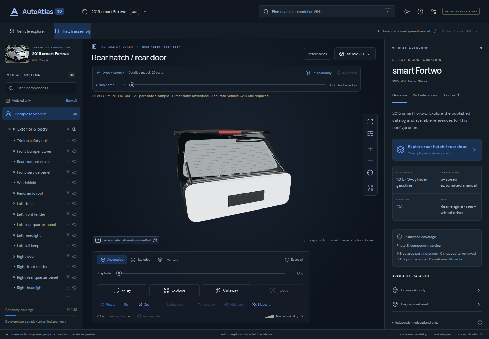

# AutoAtlas 3D

An automotive parts workspace built on the existing **React 19, TypeScript, Vite 7 and Three.js 0.180** application. The first published configuration is the **2015 U.S. Smart Fortwo 451 gasoline Passion coupé**. Vehicle identity, catalog content, model coverage and replacement-part fitment are separate records.

**The primary workspace is now persistent interactive 3D. The photorealistic vehicle asset milestone is not complete.** No accurate, redistribution-approved full-vehicle or rear-hatch CAD/scan has been acquired. The default shows an explicitly labeled original 21-part hatch interaction sample; it does not load the old primitive car. Photographs and diagrams are supporting references in a dialog.



## Run and display

```sh
npm ci
npm run dev
```

Open **http://localhost:5173**. In Codespaces, open port **5173** from the Ports tab; private previews require the owning GitHub account. The current Codespace's exact hostname is allowed by Vite.

For a production build:

```sh
npm run build
npm run preview
```

Open **http://localhost:4173**. No database or API key is required. Optional VIN decoding contacts NHTSA only when the user submits a VIN. VINs are not persisted.

## Working experience

- Dark charcoal/blue interface based on the supplied reference, light theme, resizable desktop sidebars and mobile sheets.
- Vehicle registry search by make, model, year, platform and powertrain; explicit configuration selection; optional vPIC identity lookup. Unsupported vehicles retain the current vehicle and can be recorded in an exportable local coverage request.
- Two licensed photographs, gallery navigation, zoom/pan/reset, source attribution and authored part markers linked to the same selection as the tree and inspector. Figure-specific diagram callouts use the same pipeline when authorized diagrams are imported.
- 162 catalog rows: **148 parts and 14 assemblies across 8 systems**. Search names, aliases, systems and available OEM references. Read function, location, related components and source limitations.
- Modes 2–16 share one workspace. Unavailable content gives a precise reason while retaining the 3D canvas. References open separately. No shell-only model is published as a complete vehicle.
- Versioned vehicle packages, hashes, typed part definitions and separate physical instances, provider contracts, bounded downloads, cancellation, a four-package memory cache and local administrator publication tooling.
- Tested switching to a **synthetic test-only second vehicle** through the same UI, including two instances sharing one definition. It is not in the public registry and is not a second supported real vehicle.

### 3D interactions and development fixtures

The default hatch sample works in development and preview builds and can be disabled in Settings. Every sample view carries a development banner. **http://localhost:5173/?fixture=smart-451** retains the old whole-vehicle fixture solely for explicit development regression testing; the production build ignores this legacy opt-in. These are original approximate models, not validated OEM parts.

The existing vehicle supports orbit/pan/zoom, picking, focus, hide/isolate, transparency, clipping, camera presets, inventory layout and the conceptual clutch lesson. Whole-vehicle explosion is disabled without authored transforms. **Hatch assembly** loads 21 independently selectable sample components on demand with low/high GLBs, controlled separation, isolated rotation, return to assembly, and illustrative hinge/telescoping-strut motion. Model-coordinate measurement is explicitly illustrative; production measurement requires recorded scale validation.

PBR materials, a licensed HDR environment, ACES tone mapping, antialiasing, adaptive graphics quality and optional high-quality GPU ambient occlusion are supported. Meshopt geometry and local KTX2 decoding are configured. Real GPU AO and a KTX2-textured production asset still need hardware validation.

## Published coverage

| Content              | Actual status                                                                                                                                                                           |
| -------------------- | --------------------------------------------------------------------------------------------------------------------------------------------------------------------------------------- |
| Public coverage      | **Interactive hatch sample + catalog**, zero reviewed 3D parts                                                                                                                                 |
| Photographs          | M 93's 2011 European 451 facelift front/rear views, CC BY-SA 3.0 DE; exterior-location references, **not 2015 U.S. equipment evidence**. The source title/description disagree on trim. |
| Service diagrams     | No authorized vehicle-specific diagram published; import/callout pipeline tested with a synthetic raster                                                                                |
| OEM identities       | Three sourced references; **zero confirmed fitments** for this gasoline configuration. Headlamp evidence comes from an Electric Drive catalog and is labeled accordingly.               |
| Repair information   | No verified licensed removal procedure, torque value or safety sequence published                                                                                                       |
| Development geometry | 75 unique selectable groups across the original vehicle and hatch; all geometry Tier C, independently of public coverage level C                                                        |
| Providers            | Local published packages and optional NHTSA identity lookup; external parts/service providers unconfigured                                                                              |
| Database             | Three PostgreSQL migrations and normalized seed, tested with embedded PostgreSQL; no live database or editorial service provisioned                                                     |

The 148-part denominator describes this catalog slice, not a factory bill of materials. Unknown dimensions, equipment restrictions and compatibility remain unknown. Geometry fidelity, identity evidence, fitment and rights are not one “verified” badge.

## Validation and tooling

The free **Bforartists authoring workflow** is now tested end to end. Open the [editable hatch project](assets/authoring/smart-451-hatch/assembly.blend) and follow [FREE_AUTHORING](docs/FREE_AUTHORING.md) to edit individual parts and stage GLBs for the existing viewer. This project is the unverified sample; conversion does not increase reviewed geometry coverage.

```sh
npm run check
npm run lint
npm test
npm run validate:assets
npm run build
npx playwright install --with-deps chromium
npm run test:e2e
```

Browser tests reuse port 5173 or start Vite. `npm run capture` records the actual public interface; `npm run capture:hatch` records the opt-in sample. See [validation results](docs/VALIDATION.md) for tested scope and limitations.

| Command                                                                                      | Purpose                                                                            |
| -------------------------------------------------------------------------------------------- | ---------------------------------------------------------------------------------- |
| `npm run export:catalog`                                                                     | Regenerate the authoring snapshot and SQL seed                                     |
| `npm run export:vehicle`                                                                     | Export the baseline public catalog/photo package, retaining other registry entries |
| `npm run import:vehicle -- --package /path/package`                                          | Validate and stage a versioned package; write a resumable report                   |
| `npm run import:vehicle -- --package /path/package --publish`                                | Publish validated files and atomically replace the local registry pointer          |
| `npm run import:assembly -- --model source.glb --manifest reviewed.json --out /path/staging` | Validate a replacement for the first hatch assembly; does not publish              |
| `npm run export:model` / `npm run optimize:model` / `npm run export:hatch`                   | Rebuild explicitly unverified development models                                   |

[Vehicle import instructions](docs/VEHICLE_IMPORT.md) cover immutable revisions, licensing, instance mappings and publication. Asset preparation, Blender export, coordinates and required Smart geometry are documented in [ASSET_PIPELINE](docs/ASSET_PIPELINE.md) and [HATCH_REFERENCES](docs/HATCH_REFERENCES.md).

## Architecture and deployment

`ApplicationRoot` loads a registry and swaps validated vehicle packages through `CatalogProvider`. All active catalog queries use this context. The previous package remains active until the new package passes validation; stale requests are canceled. Scene unmounting disposes materials, textures, geometry, animation controllers and loaders.

Photo/catalog mode does not initialize WebGL. Three.js and postprocessing load lazily. Rendering, immutable assembly transforms, camera/input controls, material management, vehicle resolution and metadata are separate modules. See [architecture](docs/ARCHITECTURE.md) and [providers](docs/PROVIDERS.md).

Apply database migrations **001, 002, 003**, then `db/seed.sql`, through an administrative connection. Read-only catalog policies are enabled; import job reports have no public read policy. The static importer currently publishes JSON/files, not a remote database. Never place provider credentials or service-role keys in the client. Seed upserts update reviewed identity rows; review before applying to a database with separate editorial changes.

`vercel.json` retains the existing Vite deployment (`npm ci`, `npm run build`, `dist`). Any static HTTPS host at its root can serve the build. No public production deployment is performed here.

## Remaining dependencies

Acquire an appropriately licensed **451 gasoline U.S. coupe** vehicle and separated hatch asset, with source measurements, identity mapping, low/high detail, PBR textures and recorded human review. Then validate import, fit and scale before enabling production model modes. Add licensed service/fitment providers and real diagrams separately. Benchmark physical desktop/mobile GPUs and validate Safari, Firefox, touch and assistive technology.

The supplied concept image guides layout, not geometry, part identifiers, engine placement or repair steps. [Progress](docs/PROGRESS.md) records completed work and remaining tasks. Code and original samples are MIT; photographs, HDR and decoder licenses are separate in [ASSET_LICENSES](ASSET_LICENSES.md).

## Permanent 3D workspace correction

X-ray, authored assembly explosion, directional cutaway and part focus operate in one retained canvas. X-ray uses explicit exterior groups; internal components remain opaque and selectable. Cutaway supports front/rear/left/right/upper planes, custom position, and exterior-only or all-component clipping. Bounds are measured from installed parts. Blue highlighting, independent isolated rotation, hide/restore, camera presets and supporting references retain stable catalog IDs.

The default has 21 **sample** mappings and 0 reviewed mappings. All 148 catalog parts remain available. Returning to the complete vehicle explains the missing accurate asset rather than substituting imagery or an inaccurate model. See [asset audit and sourcing steps](docs/ASSET_SOURCING.md), [import workflow](docs/VEHICLE_IMPORT.md), and [actual visual validation](docs/WORKSPACE_VALIDATION.md).
